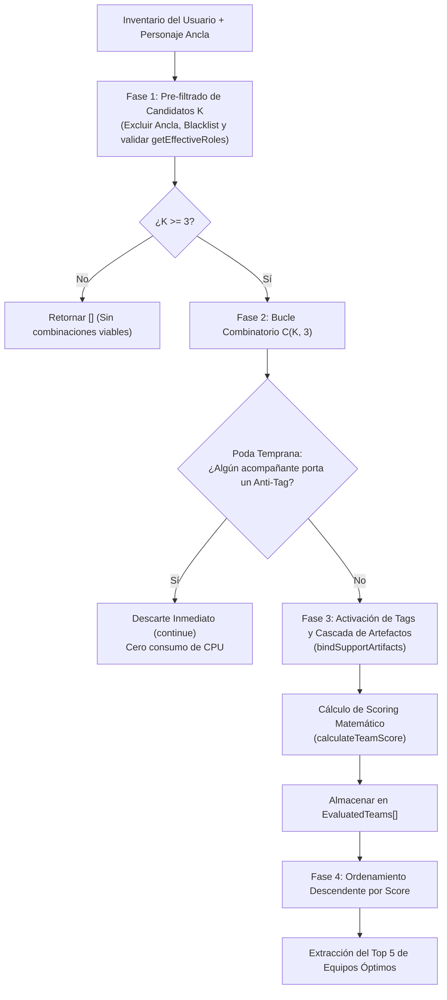

# Anexo C. Motor de Matching y Algoritmo de Recomendación Combinatoria

**Propósito:** El propósito de este módulo es la generación, poda combinatoria y jerarquización de composiciones de equipo de cuatro integrantes a partir del inventario real del jugador, garantizando el descarte estricto de incompatibilidades mecánicas duras (*anti-tags*) y entregando los cinco mejores equipos (*Top 5*) optimizados para el personaje ancla.

---

### C.1 – Principios de búsqueda combinatoria y poda temprana

El proceso de recomendación inicia fijando un personaje ancla con rol de *Main DPS* ($Carry$). El objetivo computacional consiste en seleccionar el trío óptimo de acompañantes ($A_1, A_2, A_3$) a partir de un subconjunto de $K$ personajes disponibles en el inventario del usuario, lo que formula un problema de combinatoria sin repetición:

$$C(K, 3) = \binom{K}{3} = \frac{K(K - 1)(K - 2)}{6}$$

Para una cuenta con 30 personajes habilitados como soporte, el espacio de búsqueda genera $\binom{30}{3} = 4,060$ combinaciones posibles. Someter cada una de estas ternas a evaluaciones complejas de artefactos y scoring resultaría ineficiente; por lo tanto, el algoritmo aplica un **filtrado previo del catálogo (Pre-filtering)** antes de ingresar al bucle combinatorio:

1. **Exclusión de identidad y Blacklist:** Se excluye al propio personaje ancla y a cualquier unidad marcada en la lista de veto del usuario (`blacklist`), reservando personajes que el jugador desee mantener en un segundo equipo de Abismo.
2. **Elegibilidad por roles dinámicos según constelación (`getEffectiveRoles`):** Un personaje solo se incorpora al conjunto de candidatos $K$ si puede desempeñar operativamente los roles de *Sub-DPS*, *Support* o *Healer*. Esta condición es dinámica: por ejemplo, unidades como **Klee** se restringen al rol de *Main DPS* en $C_0/C_1$, pero a partir de $C_2$ desbloquean formalmente la etiqueta de *Support* al incorporar una reducción de Defensa del $-23\%$ con sus minas. De manera idéntica, **Razor** se habilita como soporte reductor de Defensa exclusivamente a partir de $C_4$.

---

### C.2 – Reglas de exclusión y descarte por incompatibilidad mecánica (Anti-Tags)

El núcleo de integridad del motor combinatorio radica en su capacidad de **poda dura (*Hard Constraints*)**. A diferencia de las penalizaciones numéricas leves que simplemente reducen el puntaje, ciertas combinaciones quiebran de raíz la jugabilidad del carry.

El caso paradigmático corresponde a los **Carries de daño físico puro (Razor y Eula)**:
* **Mecánica del Carry:** Estos personajes basan su escalado en daño no elemental (daño blanco), potenciado por cálices de Bono de Daño Físico y reducciones de resistencia física enemiga mediante la reacción de Superconductor.
* **El conflicto de infusión:** Habilidades como el campo de Chongyun (*Espíritu quebrantahielos*) o la constelación 6 de Bennett (*Fuego y coraje*) imbuyen las armas cuerpo a cuerpo en Cryo o Pyro respectivamente. Esta conversión elemental sobrescribe y anula el daño físico del carry, destruyendo su efectividad en combate.

Para solucionar este fallo crítico sin intervención manual, el sistema dota al ancla de una lista de atributos prohibidos (`antiTags`):

| Personaje Ancla | Daño Profile | Etiquetas Incompatibles (`antiTags`) | Razón Táctica de la Poda |
|---|---|---|---|
| **Razor** | `Physical Melee` | `cryo_infusion`, `pyro_infusion` | La infusión elemental sobreescribe el daño físico y anula los bonos de Cáliz/Superconductor. |
| **Eula** | `Physical Melee` | `cryo_infusion`, `pyro_infusion` | Anula el daño básico físico en la ventana de carga de la Espada Luminosa. |
| **Keqing** | `Electro Fast Melee` | `cryo_infusion` | Chongyun destruye la conversión Electro de su habilidad elemental. |
| **Tighnari** | `Dendro Charged Bow` | `pyro_application` (aislado) | Quemadura consume el aura Quicken e impide activar la reacción de Propagación (*Spread*). |

Durante la generación de ternas, si algún integrante del trío activa un tag prohibido para el ancla, **la combinación se descarta de forma instantánea** en la primera instrucción del bucle combinatorio, asignándole un puntaje conceptual de $-\infty$ y evitando que pase a las fases de asignación de artefactos o puntuación.

Un detalle técnico fundamental es la **sensibilidad a las constelaciones**: Bennett a $C_1-C_5$ es reconocido como el mejor buffer de Ataque para Razor o Eula; sin embargo, si el usuario registra a Bennett en $C_6$ en su inventario, el motor activa automáticamente la etiqueta `pyro_infusion`, provocando su expulsión inmediata de las recomendaciones para dichos carries físicos.

---

### C.3 – Implementación en código

El algoritmo completo de matching reside en el archivo [`server/src/shared/affinity-engine/matcher.ts`](file:///home/tyreans/metips/vgbuilder/server/src/shared/affinity-engine/matcher.ts) mediante la función principal [`findOptimalTeams`](file:///home/tyreans/metips/vgbuilder/server/src/shared/affinity-engine/matcher.ts#L64).

Su ejecución se articula en cuatro fases operativas consecutivas:



#### 1. Depuración del conjunto de candidatos según constelación
Antes de iniciar las combinaciones, se construye el vector `candidateEntries` validando si el personaje califica como soporte a su constelación actual:

```typescript
// matcher.ts líneas 80-104
const candidateEntries: CompanionEntry[] = [];

for (const item of input.inventory) {
  const charIdStr = String(item.characterId);
  if (charIdStr === String(targetCarry.id) || blacklist.has(charIdStr)) continue;

  const charData = catalog.characters.find((c) => c.id === item.characterId);
  if (!charData) continue;

  // Determinar roles efectivos según constelación (Klee C2+, Razor C4+, Amber C6+)
  const eligibleRoles = ["sub-dps", "support", "healer"];
  const charConstellation = item.constellation ?? 0;
  const effectiveRoles = getEffectiveRoles(charData, charConstellation);

  if (effectiveRoles.some((r) => eligibleRoles.includes(r.toLowerCase()))) {
    candidateEntries.push({ character: charData, constellation: charConstellation });
  }
}
```

#### 2. Bucle combinatorio y descarte inmediato por Anti-Tags
Se recorren las ternas posibles. La primera verificación examina si alguna mecánica activa del acompañante coincide con los `antiTags` del carry:

```typescript
// matcher.ts líneas 115-141
const antiTagValues = new Set((targetCarry.antiTags ?? []).map((at) => at.value));

for (let i = 0; i < K - 2; i++) {
  for (let j = i + 1; j < K - 1; j++) {
    for (let k = j + 1; k < K; k++) {
      const trio: CompanionEntry[] = [
        candidateEntries[i],
        candidateEntries[j],
        candidateEntries[k],
      ];

      // Verificación de Hard Constraints (Anti-Tags del Carry)
      let hasConflict = false;
      for (const comp of trio) {
        for (const m of comp.character.mechanics) {
          // Ignorar mecánicas bloqueadas por falta de constelación
          if (m.minConstellation && comp.constellation < m.minConstellation) continue;
          
          if (antiTagValues.has(m.value)) {
            hasConflict = true;
            break;
          }
        }
        if (hasConflict) break;
      }

      if (hasConflict) continue; // Poda instantánea sin cálculo de scoring
```

#### 3. Inyección de artefactos de soporte y puntuación
Aquellas combinaciones que superan la poda de compatibilidad proceden a la asignación de sets de 4 piezas mediante el módulo `bindSupportArtifacts` (evitando duplicidad de pasivas como Nobleza o Tenacidad) antes de computar el puntaje con `calculateTeamScore`:

```typescript
// matcher.ts líneas 176-193
      // Asignación de artefactos de soporte sin duplicidad
      const { assignments, injectedTags } = bindSupportArtifacts(
        trio,
        targetCarry,
        catalog.artifactSets,
        catalog.artifactBinds
      );

      // Evaluación del puntaje total con tags activos + artefactos inyectados
      const scoreResult = calculateTeamScore(
        targetCarry,
        trio,
        activeTags,
        injectedTags,
        catalog.presets,
        catalog.tagAffinities
      );
```

#### 4. Ordenamiento y extracción del Top 5
Finalmente, el conjunto de equipos válidamente evaluados se ordena en orden descendente y se extraen las cinco mejores alineaciones:

```typescript
// matcher.ts líneas 236-245
  // Ordenar combinaciones por puntuación total descendente
  evaluatedTeams.sort((a, b) => b.totalScore - a.totalScore);

  // Seleccionar los 5 mejores equipos
  const topTeams = evaluatedTeams.slice(0, 5);
  topTeams.forEach((team, idx) => {
    team.rank = idx + 1;
  });

  return topTeams;
```

---

### C.4 – Conclusión

El diseño del algoritmo de matching combinatorio resuelve con éxito el balance entre **exhaustividad analítica y eficiencia computacional**, ofreciendo ventajas directas en la arquitectura del recomendador:

1. **Eficiencia por poda temprana:** Al descartar las combinaciones con anti-tags en la primera instrucción del bucle combinatorio, se evita ejecutar las fases costosas de asignación de artefactos y scoring sobre miles de combinaciones incompatibles, logrando tiempos de ejecución inferiores a los $80\text{ ms}$ para un inventario estándar.
2. **Robustez ante el metajuego real:** Se garantiza que personajes con restricciones mecánicas severas (como atacantes físicos frente a infusiones indeseadas) nunca reciban recomendaciones erróneas que perjudiquen la experiencia del usuario, adaptándose dinámicamente a las constelaciones registradas.
3. **Jerarquización transparente (Top 5):** Al acotar el resultado a los cinco mejores equipos evaluados, el usuario recibe un abanico claro de opciones (desde la alineación cumbre de máximo DPS hasta alternativas con mayor comodidad defensiva), acompañadas del desglose pormenorizado de su arquetipo y artefactos asignados.

Como trabajo futuro, se proyecta la implementación de técnicas de poda predictiva (*Branch and Bound*) que permitan interrumpir ramas completas del espacio combinatorio cuando el techo teórico de una combinación no pueda superar el umbral del quinto puesto ya registrado, optimizando aún más el procesamiento en dispositivos móviles con catálogos ampliados de personajes.
