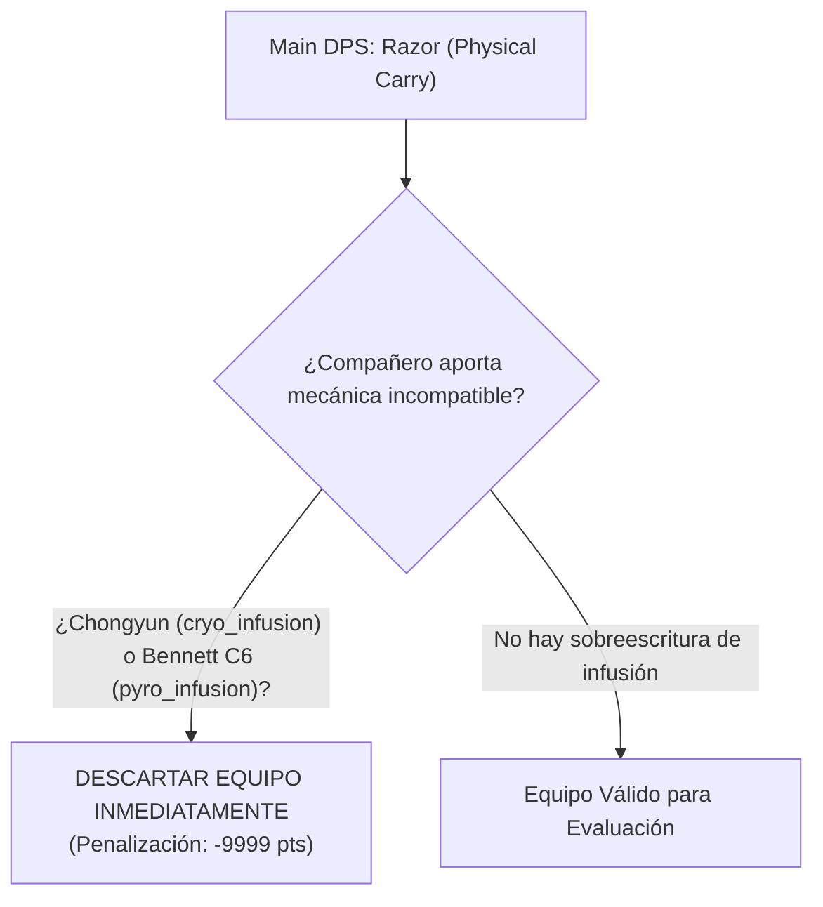
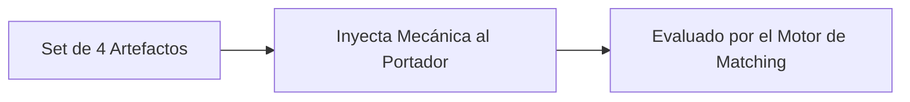
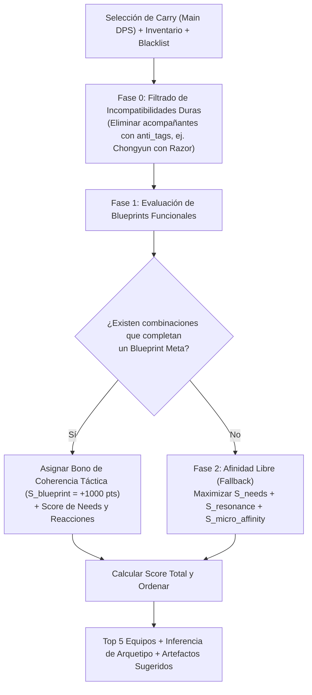

# Bitácora de Investigación Técnica: Motor de Matching de Equipos (VGBuilder)

> **Estado:** PROTOTIPO 1 CONSOLIDADO / Fase 2 — Modelo de Datos, Taxonomía KQM y Seed Implementados  
> **Última actualización:** 24 de Octubre de 2026 (Cierre de Hito: Prototipo 1)  
> **Fuentes analizadas:** `Premisa.txt`, `Task 1.1.2 - Definicion Taxonomia de Tags.pdf`, `db/schema.ts`, `db/seed.ts`, `Respuestas1.txt`, `Respuestas2.txt`, `Respuestas3.txt`.

---

## 1. Visión y Premisa del Proyecto

### 1.1 El Problema Fundamental
* **Saturación y variedad:** Genshin Impact cuenta con más de 120 personajes (~50 diseñados como fuentes de daño principal / Main DPS). Esto genera la denominada *"parálisis por análisis"*.
* **La falacia del meta de guías:** Las guías convencionales recomiendan composiciones teóricamente óptimas (ej. *Hu Tao + Xingqiu + Yelan + Zhongli*), pero ignoran la realidad del jugador: dependen de múltiples personajes de 5 estrellas de *banners* promocionales temporales que requieren *Protogemas* (recurso escaso para jugadores F2P / de presupuesto bajo).
* **Falta de soluciones personalizadas:** No existe una herramienta ágil que le diga al jugador: *"Dado exactamente lo que tú posees en tu cuenta hoy, este es el mejor equipo posible para potenciar a tu personaje favorito"*.

### 1.2 La Propuesta de VGBuilder
**VGBuilder** es un motor de recomendación inteligente cuyo núcleo es el **Motor de Afinidad de Equipos**.
* **Objetivo:** Encontrar los **5 mejores equipos** de 4 personajes óptimos centrados en un personaje **Main DPS** seleccionado por el usuario.
* **Variables consideradas:**
  * **Inventario real:** Exclusivamente los personajes que el usuario posee.
  * **Constelaciones ($C_0$ a $C_6$):** Nivel de duplicados del personaje en posesión del usuario, ya que desbloquean mecánicas críticas.
  * **Lista de exclusión (Blacklist):** Capacidad del usuario para retirar personajes ya asignados a otro equipo (ej. Equipo 1 del Abismo) o descartados por preferencia de gameplay.
  * **Sets de Artefactos Clave:** Sets de soporte de 4 piezas que no dependen de substats y otorgan mecánicas universales (VV, Nobleza, Tenacidad, etc.).
* **Variables expresamente excluidas:**
  * **Nivel del personaje (1 a 90):** Subir de nivel solo requiere tiempo/resina in-game y no azar gacha.
  * **Misiones de mejora/QoL:** Misiones como *"Noche de las Brujas"* (`Hexerei`) y *"Revelación del Oráculo"* (`Witch`) son accesibles para todos los que posean al personaje sin coste de protogemas adicionales.

---

## 2. Auditoría Crítica de la Taxonomía Actual (`ROSTER` y `seed.ts`)

Analizando el código actual de [`seed.ts`](file:///c:/Users/NOVA/Desktop/Motor%20Genshin%20Impact/db/seed.ts) y la taxonomía del PDF, se detectan **debilidades estructurales críticas** que provocarían emparejamientos defectuosos si no se corrigen:

### 2.1 Carencias Detectadas en el Modelo de Tags Actual:

1. **Falta de Especificación del Tipo de Daño Primario del Carry (`damage_profile`):**
   * *Problema:* Actualmente solo se etiqueta `rol: "Main DPS"`. Pero **Razor** es un carry de **daño Físico**, mientras que **Diluc** es **Pyro**, **Keqing** es **Electro**, y **Ningguang** es **Geo**.
   * *Impacto:* Sin esta etiqueta, el motor no puede saber que Razor necesita `superconduct` (-40% física) y que un buffer de `buff_electro_dmg` apenas le sirve para una fracción minúscula de su daño total.
2. **Ausencia de Tags de Conflicto / Anti-Sinergias (`anti_tags` / Incompatibilidades):**
   * *Problema:* Ciertas habilidades sobrescriben el tipo de daño del arma cuerpo a cuerpo:
     * `cryo_infusion` (Chongyun E): Sobrescribe ataques a Cryo.
     * `pyro_infusion` (Bennett C6): Sobrescribe ataques a Pyro.
   * *Impacto:* Si el motor empareja a **Razor** con Chongyun o Bennett C6, **arruina el personaje** al anularle su daño físico. Lo mismo ocurre si empareja a **Keqing** con Chongyun (destruye su infusión Electro).
3. **Mecánicas de Rango vs. Aura de Proximidad (`targeting_range`):**
   * *Problema:* `off_field_cryo_dmg` de Kaeya es un **aura orbital a corta distancia** que gira alrededor del personaje activo.
   * *Impacto:* Para atacantes cuerpo a cuerpo (Diluc, Razor) es perfecto. Pero para catalizadores o arqueros a distancia (**Klee**, Yanfei, Yoimiya) que se quedan anclados lanzando ataques a distancia, el aura de Kaeya no toca a los enemigos a menos que el jugador juegue pegado a ellos.
4. **Gatillo de Ataques Coordinados (`coordinated_attacks`):**
   * *Problema:* Las definitivas de Xingqiu y Beidou se activan **únicamente al realizar Ataques Normales**.
   * *Impacto:* Para Keqing o Diluc funciona natural. Pero personajes orientados a Ataques Cargados puros (o Klee cuando abusa de cargados) requieren tejer básicos en su rotación para no perder la aplicación Hydro/Electro.
5. **Inconsistencias Detectadas en [`seed.ts`](file:///c:/Users/NOVA/Desktop/Motor%20Genshin%20Impact/db/seed.ts):**
   * **Noelle:** En `seed.ts` está etiquetada solo como `Support`. Pero en el PDF y en el juego real es un personaje híbrido (`main_dps/support`), especialmente a C6 donde se convierte en un carry Geo devastador.
   * **Chongyun:** En `seed.ts` aparece como `Support`, pero en el PDF es `sub_dps/support` (aporta burst Cryo considerable fuera de campo).
   * **Amber:** En `seed.ts` solo figura como `Support`, omitiendo su rol de `sub_dps`.
   * **Qiqi:** En `seed.ts` tiene el tag `coordinated_attacks`. En la mecánica real de Genshin, la esfera de Qiqi gira en intervalos fijos temporales (aura periódica), no reacciona en sincronía con los ataques del personaje activo (a diferencia de Xingqiu o Beidou).

---

## 3. Modelo de Anti-Sinergias y Restricciones Duras de Incompatibilidad

Para resolver casos como Razor o Keqing, el motor debe incorporar una **Lista de Incompatibilidades Duras**:

### Tabla de Incompatibilidades Directas:

| Main DPS / Condición | Mecánica Incompatible (`anti_tag`) | Personaje Ejemplo que lo provoca | Motivo Jugable |
|---|---|---|---|
| **Razor (Físico)** | `cryo_infusion`, `pyro_infusion` | Chongyun, Bennett (C6) | Transforma su daño blanco físico en elemental, perdiendo todo el bono de copas físicas y Superconductor. |
| **Keqing (Electro)** | `cryo_infusion`, `pyro_infusion` | Chongyun, Bennett (C6) | Sobrescribe la conversión Electro de su Habilidad Elemental. |
| **Ayaka / Keqing** | Dispersión por Sobrecarga (`overload`) en enemigos ligeros | Xiangling/Bennett sin control | La sobrecarga empuja a los enemigos lejos del rango de la espada corta. |

---

## 4. Análisis de los 6 Main DPS Iniciales y sus Blueprints Meta

Basado en el análisis de los 21 personajes iniciales, definimos las plantillas y composiciones óptimas para cada uno:

### 4.1 Klee (Pyro / Catalyst - Rango Medio/Distancia)
* **Perfil:** Daño Pyro constante en área. Requiere protección porque sus animaciones de lanzamiento la dejan vulnerable y anclada.
* **Composiciones Clave:**
  1. *Vaporizados Rango:* Klee + Xingqiu + Mona + Noelle/Bennett.
  2. *Vaporizados Doble Buffer:* Klee + Xingqiu + Bennett + Sucrose (bajada VV + bono de Maestría).
  3. *Derretidos Proximidad:* Klee + Kaeya + Bennett + Noelle/Sucrose (requiere posicionamiento agresivo).
* **Blueprint:** `[Klee] + [hydro_application / cryo_application] + [buff_attack / crowd_control] + [shield / healer]`.

### 4.2 Diluc (Pyro / Claymore - Cuerpo a Cuerpo On-Field)
* **Perfil:** Golpes pesados cuerpo a cuerpo con infusión Pyro continua. Teje ataques normales con habilidad elemental de forma perfecta.
* **Composiciones Clave:**
  1. *Vaporizado Canónico:* Diluc + Xingqiu + Bennett + Sucrose (activa Xingqiu en cada básico).
  2. *Derretidos Cuerpo a Cuerpo:* Diluc + Kaeya + Bennett + Sucrose (el aura de Kaeya rota en perfecta sincronía con el rango melee de Diluc).
* **Blueprint:** `[Diluc] + [off_field_hydro_dmg / off_field_cryo_dmg] + [buff_attack / battery] + [anemo_application / shield]`.

### 4.3 Keqing (Electro / Sword - Rápida / Teletransporte)
* **Perfil:** Alta cadencia de ataques cargados y definitivas de bajo coste de energía.
* **Composiciones Clave:**
  1. *Taser / Electrocargado:* Keqing + Xingqiu + Fischl + Sucrose (alta generación de partículas y daño continuo sin interrupciones).
  2. *Hypercarry Electro:* Keqing + Bennett + Sucrose + Noelle/Fischl.
  3. *Sobrecarga:* Keqing + Bennett + Xiangling + Noelle/Fischl.
* **Blueprint:** `[Keqing] + [off_field_hydro_dmg / off_field_electro_dmg] + [buff_attack / crowd_control] + [sustain]`.

### 4.4 Ningguang (Geo / Catalyst - Daño Monoelemental de Proyectiles)
* **Perfil:** Daño Geo explosivo a distancia. No depende de reacciones elementales multiplicativas; maximiza su daño a través de estadísticas puras, consonancias y campos de buff.
* **Composiciones Clave:**
  1. *Doble Geo + Doble Pyro:* Ningguang + Noelle + Bennett + Xiangling (Resonancia Geo +15% daño con escudo + Resonancia Pyro +25% ATK).
* **Blueprint:** `[Ningguang] + [geo_resonance_partner: Noelle] + [pyro_resonance_1: Bennett] + [pyro_resonance_2: Xiangling]`.

### 4.5 Razor (Electro / Claymore - Main DPS Físico Puro)
* **Perfil:** Atacante físico cuerpo a cuerpo que permanece en campo durante su lobo definitivo. Muy demandante de energía y protección contra interrupciones.
* **Composiciones Clave:**
  1. *Superconductor Seguro:* Razor + Qiqi + Bennett (C0-C5) + Noelle/Fischl.
  2. *Superconductor Agresivo:* Razor + Kaeya + Xingqiu + Noelle (congelado + rompehielo + superconductor).
* **Anti-tags estrictos:** Prohibido Chongyun (`cryo_infusion`) y Bennett C6 (`pyro_infusion`).
* **Blueprint:** `[Razor] + [off_field_cryo_dmg / cryo_application] + [battery / buff_attack] + [shield / healer]`.

### 4.6 Noelle (Geo / Claymore - Híbrida Main DPS / Support a C6)
* **Perfil:** A C6 convierte su altísima Defensa en un enorme ataque Geo con gran rango de barrido, curando a todo el equipo mientras ataca con su escudo activo.
* **Composiciones Clave:**
  1. *Geo Carry:* Noelle + Ningguang (Batería Geo) + Bennett + Xiangling/Fischl.
* **Blueprint:** `[Noelle] + [battery_geo: Ningguang] + [off_field_dps] + [buff_attack / buffer]`.

---

## 5. Integración del Catálogo de Artefactos Clave (Sets de Soporte)

Los artefactos en Genshin Impact no solo aportan estadísticas personales; los **sets de 4 piezas de soporte** transforman a los acompañantes en engrasadores tácticos del equipo, **inyectando tags mecánicos al portador**:

### Tabla de Sets de Artefactos y Tags que Otorgan:

| Set de Artefactos (4 Piezas) | Condición de Activación | Mecánica Inyectada al Personaje | Sinergia Principal |
|---|---|---|---|
| **Sombra Verde Esmeralda (VV)** | Provocar Torbellino (Anemo) | `debuff_[element]_res` (-40% resistencia del elemento absorbido; torbellino estelar reduce Cryo) | Indispensable en cualquier soporte Anemo (Sucrose, Venti, Jean). |
| **Ritual Antiguo de la Nobleza** | Al lanzar la Habilidad Definitiva | `buff_attack` (+20% ATK a todo el equipo) | Óptimo para Bennett, Xingqiu, Mona, Kaeya. |
| **Tenacidad de la Geoarmada** | Habilidad elemental impacta continuamente | `buff_attack` (+20% ATK) + `buff_shield_strength` (+30%) | Portadores con elementales continuas fuera de campo (Fischl, Zhongli, Layla). |
| **Pergamino del Héroe** | Realizar una reacción elemental | `buff_all_elemental_dmg` universal (+12% o +24% con Noctambulismo) | Nuevos supports (Natlan / elementos reactivos). |
| **Recuerdos del Bosque** | Habilidad elemental o definitiva impacta | `debuff_dendro_res` (-30% resistencia Dendro) | Imprescindible en cualquier equipo de daño Dendro. |
| **Son de Antaño** | Al registrar curación continua | `buff_flat_dmg` (agrega daño plano a los golpes del Carry) | Curadores puros (Qiqi, Barbara, Mika, Xianyun). |
| **Petra Arcaica** | Recoger cristal elemental de cristalización | `buff_[element]_dmg` (+35% de bono al elemento recogido) | Soportes Geo (Ningguang, Zhongli). |
| **Corazón Forjado** | Reacción estelar (Superconductor / Torbellino estelar) | `buff_attack` + `buff_stellar_dmg` para todo el equipo | Equipos estelares / variantes de superconductor. |
| **Alborada de la Estrella / Serenata** | Reacciones lunares activas | `buff_lunar_reaction_dmg` + `buff_elemental_mastery` | Equipos dedicados a nuevas mecánicas lunares. |

> [!NOTE]
> **Impacto en el Motor:**  
> Cuando el motor evalúa si un equipo satisface las necesidades del Carry (por ejemplo, Hu Tao demandando `debuff_pyro_res`), la presencia de un personaje Anemo con el set **Sombra Verde Esmeralda** satisface inmediatamente esa demanda, incluso si el kit base del personaje Anemo no poseía el debuff de forma nativa.

---

## 6. Arquitectura del Algoritmo de Matching: Jerarquía en 2 Fases

Para unir Blueprints, Demandas, Anti-Sinergias y Afinidades Libres, el algoritmo operará en **dos fases jerárquicas**:

---

## 7. Registro de Decisiones y Estado de Avance

| ID | Fecha | Decisión / Hallazgo | Impacto en el Motor |
|---|---|---|---|
| DEC-001 | 24/10/2026 | El motor toma solo personajes existentes en inventario + constelación actual. | Reduce el espacio de búsqueda del total del juego (~120) al subset del jugador (~30-60). |
| DEC-002 | 24/10/2026 | Nivel 1-90 y misiones QoL no son filtros restrictivos. | Los personajes desbloqueados siempre están disponibles para matching con su potencial pleno accesible sin gacha. |
| DEC-003 | 24/10/2026 | Evaluación con espacio de búsqueda exhaustivo ($\le 15,000$ combinaciones). | Se evalúa en memoria en < 30 ms; se garantiza encontrar el óptimo global sin heurísticas aproximadas. |
| DEC-004 | 24/10/2026 | Multi-gate con lógica OR para activación de tags. | Permite que personajes como Mona activen bonos tanto por constelación (C1) como por resonancia de brujas (`alignment_class = 2`). |
| DEC-005 | 24/10/2026 | Personaje seleccionado es siempre Main DPS; acompañantes deben tener rol `sub_dps` o `support`. | Evita conflicto de tiempo en pantalla (field-time contention). Descarta combinaciones de múltiples carrys puros. |
| DEC-006 | 24/10/2026 | El usuario no elige arquetipo; el motor lo descubre y clasifica automáticamente. | La app actúa como guía prescriptiva e informa el arquetipo (ej. Vaporizado, Mono Pyro) en el resultado. |
| DEC-007 | 24/10/2026 | Paradigma de evaluación "Offers vs. Needs" (Ofertas vs. Necesidades del Carry). | Evita sobrevalorar comodines universales y permite modular la exigencia de sustain según la autosuficiencia del carry. |
| DEC-008 | 24/10/2026 | Soporte para personajes híbridos (doble rol). | Personajes como Raiden, Noelle o Chongyun pueden actuar como ancla o como acompañantes según el contexto. |
| DEC-009 | 24/10/2026 | Salida de Top 5 + Lista de Exclusión (Blacklist). | Permite al jugador ver alternativas viables y retirar personajes ya usados en otro equipo de Abismo o no deseados. |
| DEC-010 | 24/10/2026 | Capa de Contexto de Reacciones para tags compuestas (`buff_[reaction]_dmg`). | Resuelve de forma matemáticamente exacta el problema de Mona C1 sin falsos positivos en afinidades por pares. |
| DEC-011 | 24/10/2026 | Creación de tabla `character_needs` en BD. | Desacopla las ofertas mecánicas de las demandas prioritarias ($1$ a $10$) de cada Main DPS. |
| DEC-012 | 24/10/2026 | Resonancias elementales contextualizadas al Carry. | Consonancias como Pyro (+25% ATK) o Hydro (+25% HP) solo suman puntaje sustancial si el Carry escala con ese stat. |
| DEC-013 | 24/10/2026 | Esqueletos Funcionales de Composición (Blueprints). | Modela plantillas del meta basadas en roles/mecánicas y no en nombres fijos. |
| DEC-014 | 24/10/2026 | Filtro de Incompatibilidades Duras (`anti_tags`). | Impide emparejamientos destructivos (ej. Razor o Keqing con `cryo_infusion` de Chongyun o `pyro_infusion` de Bennett C6). |
| DEC-015 | 24/10/2026 | Incorporación de Perfil de Daño del Carry (`damage_profile`). | Permite distinguir entre carrys de daño Físico (Razor), Pyro (Diluc/Klee), Electro (Keqing) o Geo (Ningguang). |
| DEC-016 | 24/10/2026 | Clasificación de Rango de Proximidad vs. Distancia. | Evita emparejar auras orbitales de contacto cuerpo a cuerpo (Kaeya) con atacantes anclados a distancia (Klee), salvo intención explícita. |
| DEC-017 | 24/10/2026 | Corrección de roles e inconsistencias en Roster inicial. | Reclasificación de Noelle (`main_dps/support`), Chongyun (`sub_dps/support`), Amber (`support/sub_dps`) y corrección de mecánicas de Qiqi. |
| DEC-018 | 24/10/2026 | Inyección de Tags por Sets de Artefactos de Soporte. | Los sets de 4 piezas (VV, Nobleza, Tenacidad, etc.) aportan tags mecánicos universales al equipo al asignarse a los soportes. |
| DEC-019 | 24/10/2026 | Principio de Offers Colectivos (Eliminación de Buffs Egoístas). | Los `offers` describen exclusivamente aportes al equipo/aliados. Mecánicas propias (infusión de Diluc, teletransporte de Keqing) se apartan a `self_profile`. |
| DEC-020 | 24/10/2026 | Generalización Funcional de Necesidades (`needs`). | Se reemplazan tags rígidos por necesidades funcionales: `need_resistance_shred`, `need_interruption_resistance`, `need_physical_shred`, y `need_reaction_enabler` flexible para Keqing. |
| DEC-021 | 24/10/2026 | Jerarquía de Infusiones (Inamovibles vs. Sobrescribibles). | Distingue infusiones absolutas por código (Noelle en Q) de personajes físicos desprotegidos (Razor) destruidos por `cryo_infusion` o `pyro_infusion`. |
| DEC-022 | 24/10/2026 | Premisa de Artefactos de Soporte (Pasiva 4pc > Substats). | Los 10 sets clave se evalúan por su utilidad pasiva de 4 piezas sin depender de RNG de substats; el jugador puede completarlos a la brevedad. |
| DEC-023 | 24/10/2026 | Consolidación del Hito: Prototipo 1. | `schema.ts` y `seed.ts` completamente reescritos con `character_needs`, `character_anti_tags`, `damage_profile`, `artifact_sets` y descripciones KQM. |
| DEC-024 | 24/10/2026 | Acumulación de Buffs con Rendimientos Decrecientes. | No se anulan tags repetidos (ej. Kazuha + Xilonen o Bennett + Nobleza); el 2do buff similar aporta 50% y el 3ero 25%. |
| DEC-025 | 24/10/2026 | Vías de Amplificación Flexibles (Reacción OR Mono-Elemental). | El Carry no fija un elemento único; compiten en igualdad la vía Vaporizado, Derretido y Mono Elemental (3+ mismo elemento + buffers). |
| DEC-026 | 24/10/2026 | Viabilidad de Diluc + Chongyun (Melt Clásico). | Se retira `cryo_infusion` de los anti-tags de Diluc (infusión en Q es prioritaria y en E derrite sus propios básicos). Anti-tags se limitan a Razor/Keqing. |
| DEC-027 | 24/10/2026 | Módulo de Bind de Artefactos de Soporte (11 Sets). | El motor asigna de forma óptima y unívoca un set 4pc a cada soporte del trío (VV a Anemo, Tenacidad a Fischl, Nobleza a Bennett, Instructor para EM, etc.) garantizando la no-duplicidad de pasivas y recomendándolo en la salida. |
| DEC-028 | 24/10/2026 | Cascada de Asignación y Alerta por Colisión de Portadores. | Si un set ya está tomado (ej. Nobleza), el segundo soporte busca otro set de utilidad (ej. Instructor). Si hay colisión forzada (ej. Xingqiu y Yelan compitiendo), el motor genera una alerta de sugerencia para que el usuario decida a quién dar la pasiva 4pc y arme al otro con daño personal. |

---

## 8. Propuesta de Taxonomía Refinada para el Roster de 21 Personajes (v2.0)

Alineada con el principio de **Offers Colectivos** y **Needs Funcionales**:

| Personaje | Elemento | Rol Primario / Secundario | Perfil Daño Carry | Offers Reales Colectivos | Demandas / Needs Funcionales (si es Main DPS) | Incompatibilidades Duras (`anti_tags`) |
|---|---|---|---|---|---|---|
| **Amber** | Pyro | Support / Sub-DPS | Pyro Burst | `taunt`, `pyro_application` (burst 6U), `buff_attack` (C6) | - | - |
| **Barbara** | Hydro | Support / Healer | Hydro Heal | `healer`, `hydro_application` (melee), `buff_hydro_dmg` (C2), `revive` (C6), `ttds_buffer` | - | - |
| **Beidou** | Electro | Sub-DPS | Electro AoE | `off_field_electro_dmg`, `coordinated_attacks`, `damage_reduction`, `interruption_resistance`, `shield` (C1), `debuff_electro_res` (C6) | `need_battery` (Electro) | - |
| **Bennett** | Pyro | Support / Healer | Pyro Buffer | `buff_attack`, `healer`, `battery`, `cleanse`, `buff_pyro_dmg` (C6), `pyro_infusion` (C6) | - | C6 arruina Físicos |
| **Chongyun** | Cryo | Sub-DPS / Support | Cryo Burst | `cryo_infusion`, `cooldown_reduction` (C2), `debuff_cryo_res`, `buff_attack_speed` | - | Arruina Físicos/Electro |
| **Diluc** | Pyro | Main DPS | Pyro Melee | `pyro_application` | `need_reaction_enabler` (10), `need_attack_buff` (8), `need_resistance_shred` (8), `need_interruption_resistance` (7) | - |
| **Fischl** | Electro | Sub-DPS / Support | Electro Single Target | `off_field_electro_dmg`, `battery`, `snapshot`, `coordinated_attacks` (C6), Hexerei | - | - |
| **Jean** | Anemo | Support / Healer | Anemo Utility | `healer` (instantánea), `cleanse`, `sunfire`, `crowd_control`, `buff_attack_speed` (C2), `debuff_anemo_res` (C4) | - | - |
| **Kaeya** | Cryo | Sub-DPS / Support | Cryo Melee | `off_field_cryo_dmg` (melee orbit), `battery`, `snapshot` | - | Distancia lejana (Klee) |
| **Keqing** | Electro | Main DPS | Electro Fast Melee | `electro_application` | `need_reaction_enabler` (Dendro/Hydro/Pyro 10), `need_resistance_shred` (9), `need_interruption_resistance` (7) | `cryo_infusion`, `pyro_infusion` |
| **Klee** | Pyro | Main DPS / Support (C2) | Pyro AoE Ranged | `pyro_application`, `battery`, `interruption_power`, `debuff_defense` (C2 -23%), `ttds_buffer`, Hexerei | `need_shield` / `need_interruption_resistance` (10), `need_hydro_app` (9), `need_crowd_control` (8) | - |
| **Lisa** | Electro | Sub-DPS / Support | Electro AoE | `off_field_electro_dmg`, `debuff_defense` (-15%), `ttds_buffer` | - | - |
| **Mona** | Hydro | Support / Sub-DPS | Hydro Buffer | `buff_all_dmg` (Omen +60%), `taunt`, `crowd_control`, `buff_vaporize_dmg` (C1 + Hexerei), `ttds_buffer` | - | - |
| **Ningguang** | Geo | Main DPS / Burst | Geo Ranged | `buff_geo_dmg` (+12%), `battery` (C2), `geo_construct` | `need_geo_partner` (10), `need_shield` (9), `need_attack_buff` (8) | - |
| **Noelle** | Geo | Support / Main DPS (C6) | Geo Tank / Carry | `shield`, `healer`, `geo_infusion_absolute` | Si DPS: `need_battery_geo` (10), `need_geo_partner` (9), `need_offfield_dps` (8) | - (Infusión Inamovible) |
| **Qiqi** | Cryo | Support / Healer | Cryo Pure Heal | `healer` (masiva), `cryo_application` (orbital), `revive` (C6), Witch Revelation | - | - |
| **Razor** | Electro | Main DPS / Support (C4) | Physical Melee | `debuff_defense` (C4 -15%), `electro_application` | `need_physical_shred` (10), `need_interruption_resistance` (8), `need_attack_buff` (7) | `cryo_infusion`, `pyro_infusion` |
| **Sucrose** | Anemo | Support | Anemo Swirl / EM | `buff_elemental_mastery` (+50 + 20%), `crowd_control`, `buff_absorbed_element_dmg` (C6), Hexerei | - | - |
| **Venti** | Anemo | Support | Anemo CC Supremo | `crowd_control` (supremo), `battery` (15 energía), `debuff_anemo_res` (C2), `debuff_absorbed_res` (C6), Hexerei | - | - |
| **Xiangling** | Pyro | Sub-DPS | Pyro Off-field 360° | `off_field_pyro_dmg`, `pyro_application` (sin ICD), `snapshot`, `buff_attack` (Guoba), `debuff_pyro_res` (C1) | `need_battery_pyro` (Bennett 10) | - |
| **Xingqiu** | Hydro | Sub-DPS / Support | Hydro Off-field | `hydro_application` (suprema), `coordinated_attacks`, `damage_reduction`, `interruption_resistance`, `healer`, `debuff_hydro_res` (C2) | - | - |

---

## 9. Estado de Entrega: Prototipo 1 y Próximos Pasos (Fase 3: Algoritmo)

Con la arquitectura de datos, taxonomía y catálogo de artefactos completados, el **Prototipo 1** queda listo para su ejecución cuando tengas acceso a tu entorno con base de datos:

1. **Archivos Implementados:**
   * [`db/schema.ts`](file:///c:/Users/NOVA/Desktop/Motor%20Genshin%20Impact/db/schema.ts): Esquema Drizzle con tablas `character_needs`, `character_anti_tags`, `artifact_sets` y `damage_profile`.
   * [`db/seed.ts`](file:///c:/Users/NOVA/Desktop/Motor%20Genshin%20Impact/db/seed.ts): Semilla completa con los 21 personajes, roles múltiples, offers colectivos, demandas numéricas (1-10), incompatibilidades duras y los 10 sets de soporte.
   * [`ROSTER_21_KQM_TAXONOMIA.md`](file:///c:/Users/NOVA/Desktop/Motor%20Genshin%20Impact/ROSTER_21_KQM_TAXONOMIA.md): Fichas completas de referencia para auditorías futuras.
   * [`BITACORA_INVESTIGACION_MOTOR_MATCHING.md`](file:///c:/Users/NOVA/Desktop/Motor%20Genshin%20Impact/BITACORA_INVESTIGACION_MOTOR_MATCHING.md): Bitácora técnica viva del proyecto.

2. **Próximo Paso Inmediato (Fase 3):**
   * Creación del motor de matching en TypeScript/Node:
     * Función combinatoria exhaustiva $\binom{K}{3}$.
     * Evaluador de puntuación (*Needs Matching* + *Blueprints* + *Contexto de Reacciones* - *Anti-Tags*).
     * Retorno del Top 5 con inferencia de arquetipo y sugerencia de sets de artefactos 4pc.
