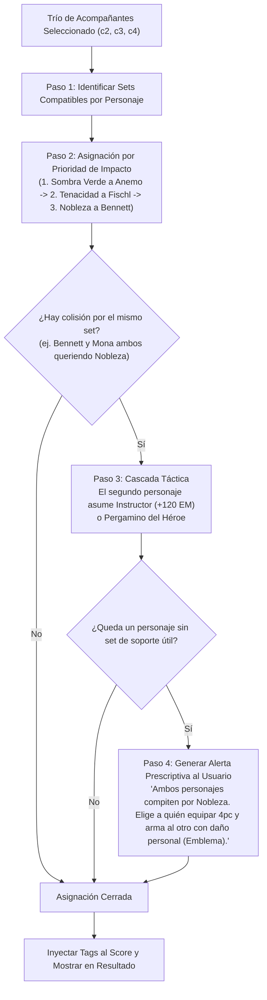

# Reporte Técnico: Actualización de Demandas (`Needs`) y Matriz de Binds de Artefactos (Estándar KeqingMains)

> **Documento:** `CAMBIOS_NEEDS_Y_BINDS_ARTEFACTOS_KQM.md`  
> **Propósito:** Documentar y justificar técnicamente ante el equipo de desarrollo los cambios incorporados en la base de datos (`schema.ts` y `seed.ts`) respecto a las demandas de los personajes (`character_needs`) y la matriz de compatibilidad de los 11 sets de soporte universal (`character_artifact_sets`), contrastados con la librería de *Theorycrafting* de **KeqingMains (KQM)**.  
> **Fecha de Emisión:** 24 de Octubre de 2026.

---

## 1. Resumen Ejecutivo de Cambios

Se han implementado en código (`db/schema.ts` y `db/seed.ts`) dos módulos clave que cierran la brecha entre la teoría matemática y la ejecución del motor:

1. **Estandarización de `character_needs` bajo el Modelo de Dos Pilares:**  
   Se desacoplaron los elementos rígidos (ej. `need_hydro_app` en Diluc o Klee) y se reemplazaron por **Demandas Funcionales** (`need_reaction_enabler`, `need_resistance_shred`, `need_interruption_resistance`), permitiendo que composiciones como *Mono Pyro*, *Vape* y *Melt* compitan de forma justa según el inventario del usuario.
2. **Creación de la Tabla Relacional `character_artifact_sets`:**  
   Se modeló la compatibilidad mecánica (*trigger eligibility*) entre los personajes de soporte y los **11 Sets de Soporte Universal**, garantizando que el motor nunca asigne un set a un personaje incapaz de activar su pasiva de 4 piezas (ej. evitar que Bennett lleve Tenacidad, o que un no-Anemo lleve Sombra Verde).
3. **Incorporación del Set #11 (*Instructor*):**  
   Set F2P de 4 estrellas que inyecta **+120 de Maestría Elemental** al provocar una reacción elemental en campo, resolviendo colisiones de soporte sin exigir gasto de resina en substats.

---

## 2. Detalle y Veracidad de Demandas (`Needs`) por Personaje (Validado con KQM)

---

### 1. Diluc (Pyro Melee On-Field Carry)
* **Perfil KQM:** Daño sostenido cuerpo a cuerpo tejiendo habilidad elemental y ataques normales imbuidos tras su Definitiva.
* **Demandas Calibradas en BD:**
  * `need_reaction_enabler` (Prioridad: **10**): Habilitador de Vaporizado (Hydro: Xingqiu/Yelan) o Derretido (Cryo: Kaeya/Chongyun). Si el equipo es Mono Pyro, la saturación de daño Pyro cubre esta demanda.
  * `need_attack_buff` (Prioridad: **8**): Bennett, consonancia Pyro o Nobleza (Diluc escala directamente con ATK).
  * `need_resistance_shred` (Prioridad: **8**): Trituración de Pyro RES (-40% vía Sombra Verde Anemo, o escudos como Zhongli/Xilonen).
  * `need_interruption_resistance` (Prioridad: **7**): Aplomo para ejecutar su combo de 3 elementales sin ser derribado (Xingqiu o escudos).
* **Anti-Tags:** Ninguno *(se retiró `cryo_infusion` tras validar la viabilidad de Melt Diluc con Chongyun)*.

---

### 2. Keqing (Electro Fast Melee Carry)
* **Perfil KQM:** Daño rápido de alta cadencia de ataques cargados y definitivas de bajo coste. Hiperversátil según el elemento acompañante.
* **Demandas Calibradas en BD:**
  * `need_reaction_enabler` (Prioridad: **10**): Flexible por diseño. Satisfecho por:
    * *Dendro* (Intensificación / Aggravate con Collei/Nahida).
    * *Hydro* (Electrocargado / Taser con Xingqiu/Fischl).
    * *Pyro* (Sobrecarga / Overload con Chevreuse/Xiangling).
  * `need_resistance_shred` (Prioridad: **9**): Trituración de Electro RES (-40% Sombra Verde VV o escudos).
  * `need_interruption_resistance` (Prioridad: **7**): Su alto consumo de aguante al abusar de cargados la deja sin estamina para esquivar; requiere aplomo o escudo.
  * `need_attack_buff` (Prioridad: **7**): Buffers de ATK.
* **Anti-Tags:** `cryo_infusion` (Chongyun) y `pyro_infusion` (Bennett C6) — destruyen su conversión Electro.

---

### 3. Klee (Pyro AoE Ranged Carry / Support C2)
* **Perfil KQM:** Daño en área explosivo y saturación masiva de Pyro. Vulnerable por baja estatura y animaciones de lanzamiento prolongadas.
* **Demandas Calibradas en BD:**
  * `need_shield` / `need_interruption_resistance` (Prioridad: **10**): **Crítico**. Un golpe enemigo interrumpe sus bombas; requiere escudo dedicado (Zhongli, Layla, Noelle).
  * `need_reaction_enabler` (Prioridad: **9**): Requiere aplicadores rápidos de Hydro (Xingqiu/Yelan) o composiciones Mono Pyro con Bennett/Xiangling.
  * `need_crowd_control` (Prioridad: **8**): Agrupadores como Sucrose o Kazuha que concentren tanto a los enemigos como las minas sueltas de su E.
  * `need_resistance_shred` (Prioridad: **8**): Reducción de Pyro RES.
* **Alineamiento:** `Hexerei`.

---

### 4. Ningguang (Geo Ranged Burst Carry)
* **Perfil KQM:** Daño Geo puro de proyectiles. Al no tener reacciones multiplicativas, depende de estadísticas directas, consonancias y campos de buff.
* **Demandas Calibradas en BD:**
  * `need_geo_partner` (Prioridad: **10**): **Indispensable**. Sin un segundo Geo (Noelle en el pool inicial), pierde el -20% Geo RES y +15% de daño de la Consonancia Geo.
  * `need_shield` (Prioridad: **9**): **Indispensable**. Requisito obligatorio para mantener activa la Consonancia Geo.
  * `need_attack_buff` (Prioridad: **8**): Bennett o consonancia Pyro para potenciar sus gemas.

---

### 5. Noelle C6 (Geo Tank / Hypercarry)
* **Perfil KQM:** Convierte su altísima DEF en un enorme ATK al activar su Definitiva, barriendo la sala en área mientras cura a todo el equipo con su escudo activo.
* **Demandas Calibradas en BD:**
  * `need_battery_geo` (Prioridad: **10**): **Crítico**. Noelle **no genera energía elemental propia** con su Habilidad Elemental. Requiere obligatoriamente un compañero Geo que actúe como batería (Ningguang, Gorou, Albedo).
  * `need_geo_partner` (Prioridad: **9**): Para activar la Consonancia Geo.
  * `need_offfield_dps` (Prioridad: **8**): Sub-DPS pasivos (Xingqiu, Fischl, Albedo) que sumen daño contra objetivos individuales mientras ella barre en área.
* **Infusión Inamovible:** `geo_infusion_absolute` (su definitiva Geo no puede ser sobrescrita).
* **Supervivencia:** No demanda escudos ni curación (ella es el tanque y el healer del grupo).

---

### 6. Razor (Physical Melee On-Field Carry)
* **Perfil KQM:** Atacante físico puro que debe permanecer en campo durante sus 15s de definitiva con el lobo activo.
* **Demandas Calibradas en BD:**
  * `need_physical_shred` (Prioridad: **10**): **Indispensable**. Requiere triturar la resistencia física enemiga; satisfecho primariamente por **Superconductor** (Cryo + Electro = -40% RES Física), o debuffers de DEF (Lisa A4, Zhongli, Rosaria C6).
  * `need_interruption_resistance` / `need_sustain` (Prioridad: **8**): Cura sostenida (Qiqi, Bennett) para tanquear golpes sin perder el lobo.
  * `need_attack_buff` (Prioridad: **7**): Buffers de ATK que no infundan elementos.
* **Anti-Tags Estrictos:** `cryo_infusion` (Chongyun) y `pyro_infusion` (Bennett C6) — prohibidos, destruyen su daño físico.
* **Alineamiento:** `Hexerei`.

---

### 7. Demandas de Sub-DPS de Alta Energía (Xiangling & Beidou)
* **Xiangling (Sub-DPS Pyro):** `need_battery_pyro` (Prioridad: **10**). Su definitiva cuesta 80 pts de energía; sin Bennett generando partículas Pyro constantes, su rotación colapsa.
* **Beidou (Sub-DPS Electro):** `need_battery` (Prioridad: **9**). Su definitiva cuesta 80 pts de energía; requiere a Fischl como batería Electro continua.

---

## 3. Matriz de Compatibilidad de los 11 Sets de Soporte Universal (`character_artifact_sets`)

Para evitar asignaciones teóricamente imposibles o que no se activan en combate, el código en [`db/seed.ts`](file:///c:/Users/NOVA/Desktop/Motor%20Genshin%20Impact/db/seed.ts) y [`db/schema.ts`](file:///c:/Users/NOVA/Desktop/Motor%20Genshin%20Impact/db/schema.ts) define qué personajes son compatibles con cada pasiva de 4 piezas:

| Set de Soporte Universal (4pc) | Mecánica Inyectada al Equipo | Gatillo / Requisito Jugable de Activación | Portadores Compatibles en Roster Inicial | Prioridad Asignada (1-10) |
|---|---|---|---|:---:|
| **Sombra Verde Esmeralda (VV)** | `debuff_elemental_res` (-40% RES al elemento del torbellino) | Provocar Torbellino (**Exclusivo de Anemo**). | **Sucrose**, **Jean**, **Venti** | **10** (BiS Absoluto) |
| **Ritual Antiguo de la Nobleza** | `buff_attack` (+20% ATK de equipo durante 12s) | Lanzar Habilidad Definitiva (Q de rotación ágil). | **Bennett** **Mona** **Kaeya** **Amber** **Chongyun** **Lisa** **Xingqiu** | 10 9 9 9 8 8 8 |
| **Tenacidad de la Geoarmada** | `buff_attack` (+20% ATK) + `buff_shield_strength` (+30%) | Daño continuo de Habilidad Elemental desde fuera de campo. | **Fischl** *(Oz continuo 100%)* **Mona** *(Pulsos de E)* **Qiqi** *(Orbe orbital)* | **10** 7 7 |
| **Instructor** *(Nuevo Set F2P)* | `buff_elemental_mastery` (+120 EM a todo el equipo durante 8s) | Provocar Reacción Elemental mientras el portador está en campo. | **Bennett** **Mona** **Sucrose** **Kaeya** **Lisa** **Amber** **Chongyun** **Barbara** | 8 9 8 8 8 9 8 6 |
| **Son de Antaño** | `buff_all_dmg` (convierte curación en daño plano directo al Carry) | Volumen masivo y sostenido de curación. | **Qiqi** **Barbara** **Jean** | **10** **10** 8 |
| **Petra Arcaica** | `buff_all_dmg` (+35% bono de daño del elemento del cristal recogido) | Provocar Cristalización y **recoger el cristal con el portador Geo**. | **Noelle** **Ningguang** | 8 8 |
| **Pergamino del Héroe** *(Natlan)* | `buff_all_dmg` (+12% o +24% bono de daño elemental universal) | Provocar Reacción Elemental del elemento del portador. | **Bennett**, **Mona**, **Fischl**, **Kaeya** | 7 |
| **Recuerdos del Bosque** | `debuff_dendro_res` (-30% RES Dendro con impactos continuos) | Impactar con Habilidad Elemental o Definitiva. | **Lisa**, **Fischl** *(en futuros equipos Dendro)* | 6 |
| **Corazón Forjado** | `buff_attack` + daño de destello estelar | Provocar reacción estelar (Superconductor / Torbellino estelar). | **Kaeya**, **Lisa**, **Fischl** | 7 |
| **Alborada de la Estrella** | `buff_all_dmg` (bono de daño a reacciones lunares) | Reacciones lunares activas en el equipo. | **Mona**, **Lisa**, **Fischl** | 7 |
| **Serenata de la Luna** | `buff_elemental_mastery` (bono EM a reacciones lunares) | Reacciones lunares activas en el equipo. | **Sucrose**, **Mona**, **Lisa** | 7 |

---

## 4. El Algoritmo de Cascada y Resolución de Conflictos (Support Artifact Binder)

En tiempo de ejecución, el motor evalúa a los 3 acompañantes seleccionados $(c_2, c_3, c_4)$ mediante el siguiente flujo voraz:

### Reglas Clave:
1. **Unicidad Estricta:** Ningún set universal de 4 piezas puede asignarse dos veces en el mismo cuarteto.
2. **Independencia de Substats:** El motor evalúa exclusivamente la pasiva mecánica del conjunto. No exige piezas legendarias perfectas, permitiendo al usuario armar a sus soportes con piezas F2P inmediatamente.
3. **Explicabilidad:** La recomendación devuelta al jugador no es abstracta; indica con precisión qué set debe llevar cada miembro del equipo.

---

## 5. Verificación de Integridad en el Código

Los siguientes archivos del repositorio reflejan fielmente esta arquitectura:
* 📄 [`db/schema.ts`](file:///c:/Users/NOVA/Desktop/Motor%20Genshin%20Impact/db/schema.ts#L102-L121): Tabla `characterArtifactSets` implementada con índices y llaves foráneas.
* 📄 [`db/seed.ts`](file:///c:/Users/NOVA/Desktop/Motor%20Genshin%20Impact/db/seed.ts#L508-L615): Catálogo de los 11 sets, definición de `ARTIFACT_BINDINGS` y sembrado de relaciones.
* 📄 [`DISENO_EN_PAPEL_ALGORITMO_SCORING.md`](file:///c:/Users/NOVA/Desktop/Motor%20Genshin%20Impact/DISENO_EN_PAPEL_ALGORITMO_SCORING.md): Fórmulas matemáticas, rendimientos decrecientes y trazas de simulación validadas.
* 📄 [`BITACORA_INVESTIGACION_MOTOR_MATCHING.md`](file:///c:/Users/NOVA/Desktop/Motor%20Genshin%20Impact/BITACORA_INVESTIGACION_MOTOR_MATCHING.md): Bitácora técnica con decisiones DEC-001 a DEC-028.
