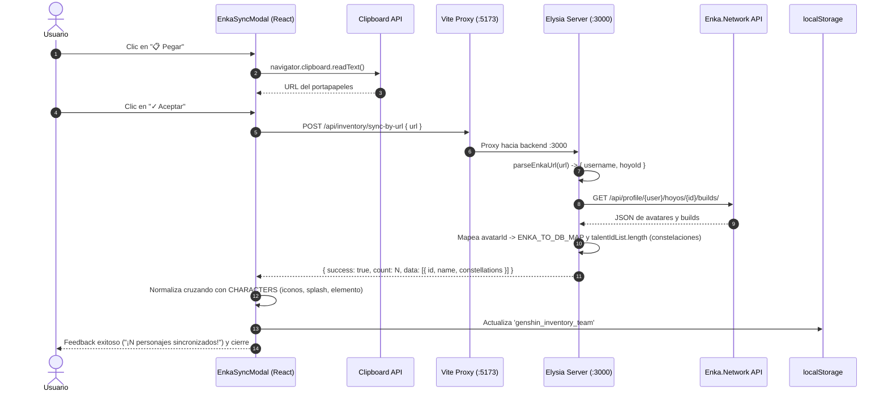

# Plan de Arquitectura y Diseño: Módulo de Sincronización con Perfiles de Enka.Network

**Epics asociados:** 
- **Epic 2:** Ingesta de Inventario del Usuario (Normalización y consumo de API)
- **Epic 4:** UI y Persistencia (Interfaz interactiva y almacenamiento en `localStorage`)

**Diseño visual asociado:** [`docs/enka-sync-popup.svg`](./enka-sync-popup.svg)

---

## 1. Visión General del Módulo

El objetivo de este módulo es permitir al usuario sincronizar de forma automática su inventario de personajes de Genshin Impact (incluyendo niveles de constelación C0–C6) pegando únicamente la URL pública de su perfil o builds en **Enka.Network**.

En lugar de requerir que el usuario configure manualmente cada personaje, el sistema:
1. Recibe la URL de Enka mediante un popup compacto.
2. Extrae y valida los identificadores (`username` y `hoyoId`).
3. Consulta el backend a través del endpoint normalizador `/api/inventory/sync-by-url`.
4. Normaliza los personajes devueltos cruzándolos con la base de datos de assets y elementos (`CHARACTERS`).
5. Persiste y fusiona el equipo directamente en `localStorage` bajo la clave `genshin_inventory_team`, reflejándose de inmediato en la interfaz reactiva del usuario.

---

## 2. Anatomía de la Interfaz (UI/UX)

Siguiendo el sistema de diseño oscuro inspirado en Spotify (`#121212`, `#181818`, acentos `#1ed760` y `#38bdf8`):

### A. Botón en la Ventana Principal (Header)
- **Ubicación:** Barra de cabecera (`.app-header`), al lado del botón existente `+ Agregar Personaje`.
- **Etiqueta recomendada:** `⚡ Sincronizar Enka` (o `Sincronizar con Enka Profile`).
- **Estilo:** Píldora secundaria (`.btn-pill .btn-pill-secondary`), con icono distintivo y efecto hover con resplandor sutil cyan.

### B. Popup / Modal Compacto
Al tratarse de una única línea de entrada (una URL de Enka), el modal no debe sobrecargar la pantalla:
- **Dimensiones:** Ancho máximo de 600px–640px, esquinas redondeadas (20px), fondo de tarjeta elevado (`#242832` a `#1b1e26`).
- **Encabezado:**
  - Título: *Sincronizar Perfil de Enka.Network*.
  - Subtítulo: *Ingresa la URL de tu perfil con builds para sincronizar automáticamente tu inventario*.
  - **Botón de Ayuda (❓):** Abre el submódulo desplegable con la guía paso a paso.
  - **Botón Cerrar (✕):** Cierra el modal; también responde a la tecla `Escape` o clic en el backdrop.
- **Campo de Texto (Textfield):**
  - Input monoespaciado de altura 48px, fondo casi negro `#14171d`.
  - Placeholder: `https://enka.network/u/tu_usuario/123456/builds/`.
  - Autofocus y soporte completo para selección de texto.
- **Barra de Acciones (3 Botones Clave + Cancelar):**
  1. **📋 PEGAR:** Utiliza la API nativa `navigator.clipboard.readText()` para vaciar el contenido del portapapeles directamente en el campo de texto con un solo clic.
  2. **🗑️ BORRAR:** Limpia el contenido del input y restablece cualquier estado previo de error.
  3. **✓ ACEPTAR:** Valida la URL, inicia la petición al backend con spinner de carga, procesa la respuesta, actualiza el `localStorage` y notifica al usuario.
  4. **Cancelar:** Acción secundaria para descartar la operación.

---

## 3. Planificación Detallada del Módulo de Ayuda

### Propósito
La mayoría de los errores de sincronización con Enka ocurren por configuraciones previas dentro del juego (perfil privado, falta de personajes en el exhibidor o no actualización de caché). El módulo de ayuda guía al usuario sin necesidad de abandonar la aplicación.

### Formato de Presentación
Un **drawer/acordeón animado** integrado directamente dentro del popup (o accesible mediante pestaña), que se expande verticalmente al hacer clic en el botón **`❓`**.

### Flujo de 4 Pasos Ilustrado:
```
┌─────────────────┐    ┌─────────────────┐    ┌─────────────────┐    ┌─────────────────┐
│  1. EN GENSHIN  │    │  2. EXHIBIDOR   │    │ 3. ENKA.NETWORK │    │ 4. PEGAR Y SYNC │
│  Paimon Menu    │───>│ Coloca hasta 8  │───>│ Ingresa con tu  │───>│ Clic en "Pegar" │
│  Editar Perfil  │    │ personajes en el│    │ UID y copia la  │    │ y luego en      │
│  Detalles: ON   │    │ exhibidor público│   │ URL del perfil  │    │ "Aceptar"       │
└─────────────────┘    └─────────────────┘    └─────────────────┘    └─────────────────┘
```

#### Contenido de cada paso:
1. **Paso 1: Configurar privacidad en Genshin Impact:**
   - Abre el juego y pulsa `Esc` (o el menú de Paimon).
   - Haz clic en los tres puntos junto a tu nombre o selecciona **"Editar Perfil"**.
   - Asegúrate de marcar la casilla **"Mostrar detalles de los personajes"**. *(Si esta casilla está desactivada, Enka no puede leer constelaciones ni estadísticas).*
2. **Paso 2: Asignar personajes al Exhibidor:**
   - En la misma ventana de perfil, selecciona hasta **8 personajes** en tu Exhibidor de Personajes.
   - Estos son los personajes que Enka.Network podrá leer y transferir a VGBuilder.
3. **Paso 3: Obtener tu enlace en Enka:**
   - Entra en [https://enka.network](https://enka.network).
   - Ingresa tu **UID** del juego (los 9 dígitos que aparecen abajo a la derecha de tu pantalla en Genshin).
   - Guarda tu perfil o abre la pestaña con builds guardadas.
   - Copia la URL de tu navegador (ej: `https://enka.network/u/TuNombre/123456789`).
4. **Paso 4: Sincronización en 1 Clic:**
   - Regresa a VGBuilder, abre este popup y pulsa el botón **"📋 PEGAR"**.
   - Pulsa **"✓ ACEPTAR"**. El sistema actualizará las constelaciones e importará todos los personajes a tu inventario local.

### Preguntas Frecuentes y Manejo de Errores:
- **"¿VGBuilder guarda mi contraseña o correo?"**  
  *No. VGBuilder nunca solicita contraseñas. Enka.Network funciona únicamente con el UID público del juego y la API oficial pública de exhibidores.*
- **"No aparecen todos mis personajes:"**  
  *Genshin Impact solo permite exhibir un máximo de 8 personajes a la vez en el perfil del juego. Si tienes más personajes guardados en builds de Enka, la URL de builds los importará automáticamente.*
- **"Error: Perfil no encontrado o privado:"**  
  *Verifica haber esperado 2-3 minutos después de cambiar tu exhibidor en el juego para que los servidores de Hoyoverse y Enka refresquen los datos.*

---

## 4. Flujo de Datos y Normalización



---

## 5. Estrategia de Actualización en `localStorage`

Para garantizar una experiencia fluida y sin pérdida de datos:
1. **Estrategia "Merge Inteligente":**
   - Si un personaje ya existe en el inventario actual del usuario, se actualiza su nivel de constelación al valor detectado en Enka.
   - Si es un personaje nuevo, se incorpora a la lista.
   - Los personajes agregados manualmente con anterioridad que no estén en el exhibidor de Enka **no se borran** (se preservan intactos).
2. **Inmutabilidad:**
   - La lista resultante se emite mediante el callback `onSyncSuccess(updatedInventory)` y se persiste inmediatamente con:
   ```typescript
   localStorage.setItem('genshin_inventory_team', JSON.stringify(updatedInventory));
   ```

---

## 6. Boceto Visual SVG

El diagrama vectorial completo se encuentra almacenado en:
📁 **[`docs/enka-sync-popup.svg`](./enka-sync-popup.svg)**

Incluye:
- Encabezado con el botón activo `⚡ Sincronizar Enka`.
- Popup centrado con diseño Spotify dark (`#1b1e26`).
- Campo de URL con resplandor cyan.
- Botones de acción rápida: **Pegar** (con portapapeles), **Borrar**, **Aceptar** y **Cerrar**.
- Submódulo visual de Ayuda en 4 etapas desplegado en la parte inferior.
