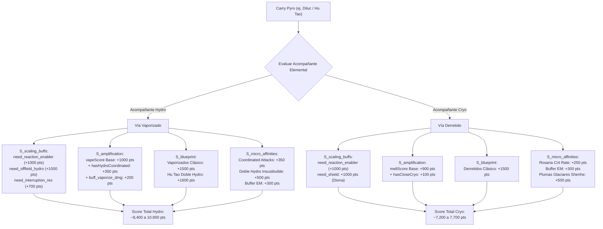

# Tabla de Afinidades de Tags y Motor de Scoring: Aplicadores Pyro vs Hydro y Cryo

> **Documento:** `TABLA_AFINIDADES_APLICADORES_PYRO.md`  
> **Ubicación:** `docs/`  
> **Referencia de Implementación:** [`scoring.ts`](file:///home/tyreans/metips/vgbuilder/server/src/shared/affinity-engine/scoring.ts) y [`roster-data.ts`](file:///home/tyreans/metips/vgbuilder/server/src/shared/affinity-engine/roster-data.ts)  
> **Módulo:** Motor de Afinidad de Equipos v2.0 (Epic 3 — VGBuilder)  
> **Estado:** Especificación Técnica y Demostración Matemática Activa  

---

## 1. Propósito y Contexto Arquitectónico

El propósito de este documento es detallar la matriz de afinidades de tags y el funcionamiento matemático exacto de la función [`calculateTeamScore`](file:///home/tyreans/metips/vgbuilder/server/src/shared/affinity-engine/scoring.ts#L14) cuando un aplicador/carry **Pyro** se empareja con un aplicador **Hydro** (reacción de **Vaporizado**) en comparación con un aplicador **Cryo** (reacción de **Derretido / Melt**).

En el motor de matching de VGBuilder, la puntuación total de un equipo se rige por la formulación v2.0 (escala de 0 a 12,000+ puntos):

$$\text{Total Score} = S_{\text{scaling\_buffs}} + S_{\text{amplification}} + S_{\text{blueprint}} + S_{\text{resonance}} + S_{\text{micro\_affinities}} - P_{\text{penalties}}$$

Donde:
* **$S_{\text{scaling\_buffs}}$**: Satisfacción de demandas primarias del Carry con curva de rendimientos decrecientes (*Diminishing Returns*).
* **$S_{\text{amplification}}$**: Multiplicador ofensivo elemental (Vaporizado continuo vs Derretido orbital vs Mono Pyro).
* **$S_{\text{blueprint}}$**: Coherencia táctica y reconocimiento de plantillas meta (*Presets*).
* **$S_{\text{resonance}}$**: Resonancias elementales contextuales (Doble Pyro +25% ATK, Doble Hydro +25% HP, Doble Cryo +15% CRIT).
* **$S_{\text{micro\_affinities}}$**: Sinergias tácticas de par (ataques coordinados, baterías, buffers de Maestría Elemental, bonos de daño).
* **$P_{\text{penalties}}$**: Penalizaciones por fallas estructurales o incompatibilidades mecánicas.

---

## 2. Catálogo de Tags: Personajes Pyro, Hydro y Cryo

Para comprender cómo se computan las puntuaciones, primero identificamos los tags clave que portan los personajes según [`roster-data.ts`](file:///home/tyreans/metips/vgbuilder/server/src/shared/affinity-engine/roster-data.ts):

### 2.1 Personajes Pyro (Carries y Aplicadores)

| Personaje | Elemento / Rol | Daño Profile | Tags Mecánicos Principales | Demandas Críticas (`needs`) |
|---|---|---|---|---|
| **Diluc** | Pyro / Main DPS | `Pyro Melee` | `pyro_application`, `pyro_infusion` | `need_reaction_enabler` (10), `need_resistance_shred` (9), `need_attack_buff` (8), `need_interruption_resistance` (7) |
| **Hu Tao** | Pyro / Main DPS | `Pyro Melee Fast` | `pyro_application`, `buff_crit_rate` | `need_reaction_enabler` (10), `need_offfield_hydro_dmg` (10), `need_shield` (10), `need_resistance_shred` (9), `need_geo_partner` (8) |
| **Yoimiya** | Pyro / Main DPS | `Pyro Ranged Fast` | `pyro_application`, `off_field_pyro_dmg`, `buff_attack` | `need_shield` (10), `need_interruption_resistance` (10), `need_offfield_hydro_dmg` (10), `need_reaction_enabler` (10), `need_attack_buff` (9), `need_resistance_shred` (9) |
| **Xiangling** | Pyro / Sub-DPS | `Pyro Melee Fast` | `off_field_pyro_dmg`, `pyro_application`, `snapshot`, `buff_attack`, `debuff_pyro_res`, `buff_pyro_dmg` | `need_offfield_pyro_dmg` (10), `need_reaction_enabler` (10), `need_attack_buff` (10), `need_resistance_shred` (9) |
| **Bennett** | Pyro / Support | `Pyro Melee` | `buff_attack`, `healer`, `battery`, `cleanse`, `pyro_application`, `pyro_infusion` (C6) | Support puro / Enabler |
| **Klee** | Pyro / Main DPS | `Pyro Ranged` | `pyro_application`, `battery`, `catalyst_buffer`, `debuff_defense` (C2) | `need_shield` (10), `need_reaction_enabler` (9), `need_crowd_control` (8) |
| **Thoma** | Pyro / Support | `Pyro Melee` | `shield`, `coordinated_attacks`, `pyro_application`, `buff_normal_attack_dmg` (C6) | Support / Shielder |

---

### 2.2 Aplicadores Hydro

| Personaje | Rol Principal | Tipo de Aplicación | Tags Mecánicos Clave | Aporte Táctico a Pyro |
|---|---|---|---|---|
| **Xingqiu** | Sub-DPS / Support | Coordinada continua a distancia/cuerpo a cuerpo (`raincutter`) | `hydro_application`, `off_field_hydro_dmg`, `coordinated_attacks`, `interruption_resistance`, `damage_reduction`, `healer` | Aplomo, microcuras y sostenimiento perfecto del aura Hydro golpe a golpe. |
| **Yelan** | Sub-DPS / Support | Coordinada continua de alta frecuencia | `hydro_application`, `off_field_hydro_dmg`, `coordinated_attacks`, `buff_all_dmg`, `battery`, `buff_hp` (C4) | Daño masivo off-field, rampa de bono de daño para el Carry y resonancia HP. |
| **Mona** | Support / Buffer | Intermitente / Burst | `hydro_application`, `off_field_hydro_dmg`, `buff_all_dmg`, `buff_vaporize_dmg`, `catalyst_buffer`, `taunt` | Presagio C1 bufa Vaporizado (+200 pts) y Libro TTDS (+48% ATK). |
| **Kokomi** | Support / Healer | Intermitente por medusa estática | `hydro_application`, `off_field_hydro_dmg`, `healer`, `continuous_healing`, `catalyst_buffer` | Supervivencia absoluta y portadora de Tenacidad de la Geoarmada o Cuento de Cazadores. |
| **Barbara** | Support / Healer | Proximidad cuerpo a cuerpo / Aura | `hydro_application`, `healer`, `catalyst_buffer`, `cleanse` | Enabler de emergencia F2P con TTDS. |

---

### 2.3 Aplicadores Cryo

| Personaje | Rol Principal | Tipo de Aplicación | Tags Mecánicos Clave | Aporte Táctico a Pyro |
|---|---|---|---|---|
| **Kaeya** | Sub-DPS | Aura orbital a corta distancia | `cryo_application`, `off_field_cryo_dmg`, `battery`, `shield` (C4) | Favorece atacantes cuerpo a cuerpo (`hasCloseCryo` -> +100 pts). |
| **Rosaria** | Sub-DPS / Buffer | Área circular estática (Lanza) | `cryo_application`, `off_field_cryo_dmg`, `buff_crit_rate`, `battery`, `debuff_physical_res` | Comparte hasta +15% Prob. CRIT (`buff_crit_rate` -> +250 pts). |
| **Chongyun** | Sub-DPS / Buffer | Campo de infusión Cryo y Burst | `cryo_infusion`, `cryo_application`, `buff_attack_speed`, `cooldown_reduction` (C2), `debuff_cryo_res` | Permite a Diluc alternar básicos Cryo con elementales Pyro para Derretidos continuos. |
| **Diona** | Support / Shielder | Ráfagas de garras y área | `cryo_application`, `shield`, `healer`, `battery`, `buff_elemental_mastery` (C6) | Escudo, curación y +200 ME a C6 para derretidos colosales. |
| **Shenhe** | Support / Buffer | Habilidad y Definitiva | `cryo_application`, `buff_cryo_flat_dmg`, `buff_cryo_dmg`, `debuff_cryo_res` | Inyección de daño plano a golpes Cryo. |
| **Ganyu** | Sub-DPS / Carry | Lluvia de carámbanos en área amplia | `cryo_application`, `off_field_cryo_dmg`, `buff_cryo_dmg`, `taunt` | Aplicación Cryo off-field constante en gran área. |

---

## 3. Tabla Maestra de Afinidades de Tags (Ponderaciones Directas)

En [`roster-data.ts`](file:///home/tyreans/metips/vgbuilder/server/src/shared/affinity-engine/roster-data.ts#L1636), la tabla de afinidades estáticas [`DEFAULT_TAG_AFFINITIES`](file:///home/tyreans/metips/vgbuilder/server/src/shared/affinity-engine/roster-data.ts#L1636) define las ponderaciones empíricas entre pares de tags elementales y mecánicos:

| Tag A (Pyro / Demanda) | Tag B (Hydro / Cryo / Aporte) | Peso Base (`weight`) | Arquetipo / Justificación Mecánica |
|---|---|:---:|---|
| `pyro_application` | `hydro_application` | **1,000 pts** | **Reacción de Vaporizado (Vape):** Multiplicador $\times 1.5$ de Pyro sobre Hydro (aura subyacente persistente gracias al gauge ratio 1:2). |
| `pyro_application` | `cryo_application` | **950 pts** | **Reacción de Derretido (Melt):** Multiplicador $\times 2.0$ de Pyro sobre Cryo. Ponderado en 950 pts debido al consumo agresivo del aura (gauge 2:1 que requiere mayor cadencia Cryo). |
| `need_reaction_enabler` | `hydro_application` | **1,000 pts** | Satisface la demanda elemental primordial de un Carry Pyro con enabler Hydro. |
| `need_reaction_enabler` | `cryo_application` | **1,000 pts** | Satisface la demanda elemental primordial de un Carry Pyro con enabler Cryo. |
| `need_offfield_hydro_dmg`| `hydro_application` | **1,000 pts** | Requisito indispensable para carries como Hu Tao o Yoimiya para no desincronizar el aura. |
| `buff_vaporize_dmg` | `pyro_application` | **400 pts** | Mona C1 / Efecto Presagio amplifica el daño del Vaporizado directo. |
| `coordinated_attacks` | `pyro_application` | **600 pts** | Ataques coordinados disparados por los combos de básicos del Carry Pyro en campo. |
| `need_interruption_resistance` | `interruption_resistance` | **700 pts** | Aportado de forma nativa por Xingqiu mediante sus Espadas de Lluvia. |
| `buff_elemental_mastery` | `hydro_application` / `cryo_application` | **300 pts** | La Maestría Elemental escala de forma exponencial el daño de Vaporizados y Derretidos. |
| `buff_crit_rate` | `pyro_application` | **250 pts** | Aportado por Rosaria para asegurar los golpes críticos amplificados. |
| `shield` | `pyro_application` | **400 - 1,000 pts** | Diona o Thoma protegiendo al Carry Pyro frágil de interrupciones. |

---

## 4. Desglose del Algoritmo en `scoring.ts`: ¿Cómo se Suman las Puntuaciones?

A continuación se detalla la implementación exacta en el código de [`calculateTeamScore`](file:///home/tyreans/metips/vgbuilder/server/src/shared/affinity-engine/scoring.ts#L14) para cada término de la ecuación:



---

### 4.1 Capa 1: $S_{\text{scaling\_buffs}}$ — Satisfacción de Demandas con Rendimientos Decrecientes

En las líneas [`64-241`](file:///home/tyreans/metips/vgbuilder/server/src/shared/affinity-engine/scoring.ts#L64-L241) de `scoring.ts`, el motor revisa la lista `targetCarry.needs`. Cada necesidad satisfecha suma según su prioridad base y el número de fuentes activas ($k$):

$$\text{needScore} = \sum_{k=1}^{\text{matchSources}} \text{baseValue} \times \text{factor}(k)$$

Donde $\text{baseValue} = \text{priority} \times 100$, y la curva de rendimientos decrecientes aplica:
* **Fuente 1 ($k=1$):** $100\%$ del valor base.
* **Fuente 2 ($k=2$):** $50\%$ del valor base.
* **Fuente 3 ($k=3$):** $25\%$ del valor base.

#### Comparación de `need_reaction_enabler` para Carry Pyro:
```typescript
// scoring.ts líneas 77-96
if (need.value === "need_reaction_enabler") {
  if (targetCarry.element === "Pyro") {
    const hydroSources = companions.filter((c) =>
      c.character.mechanics.some((m) => m.value === "hydro_application" && ...)
    ).length;
    const cryoSources = companions.filter((c) =>
      c.character.mechanics.some((m) => m.value === "cryo_application" && ...)
    ).length;

    if (hydroSources > 0) matchSources += hydroSources;
    else if (cryoSources > 0) matchSources += cryoSources;
    else if (pyroCount >= 3 && hasVV) matchSources += 1;
  }
}
```

* **Con 1 aplicador Hydro (ej. Xingqiu):**
  * $\text{matchSources} = 1 \implies \mathbf{+1,000\text{ pts}}$ (si prioridad = 10).
* **Con 2 aplicadores Hydro (ej. Xingqiu + Yelan):**
  * $\text{matchSources} = 2 \implies 1,000 + (1,000 \times 0.5) = \mathbf{+1,500\text{ pts}}$.
* **Con 1 aplicador Cryo (ej. Kaeya o Rosaria, sin Hydro en equipo):**
  * $\text{matchSources} = 1 \implies \mathbf{+1,000\text{ pts}}$.

#### Otras demandas complementarias:
1. **`need_interruption_resistance` (Prioridad 7 en Diluc, 10 en Yoimiya):**
   * Satisfecha por **Xingqiu** (`interruption_resistance`): **+700 a +1,000 pts**.
   * Cryo común (Kaeya/Rosaria) NO lo aporta por sí solo.
2. **`need_offfield_hydro_dmg` (Prioridad 10 en Hu Tao / Yoimiya):**
   * Satisfecha exclusivamente por aplicadores Hydro con `off_field_hydro_dmg` o `coordinated_attacks` (Xingqiu / Yelan): **+1,000 pts** (o **+1,500 pts** si van ambos).
3. **`need_shield` (Prioridad 10 en Hu Tao / Yoimiya / Klee):**
   * Satisfecha por **Diona** (Cryo) o **Thoma** (Pyro) o **Zhongli** (Geo): **+1,000 pts**.

---

### 4.2 Capa 2: $S_{\text{amplification}}$ — Reacción Elemental de Vaporizado vs Derretido

En las líneas [`265-309`](file:///home/tyreans/metips/vgbuilder/server/src/shared/affinity-engine/scoring.ts#L265-L309), el motor computa el multiplicador ofensivo específico para Pyro:

```typescript
// scoring.ts líneas 270-291
if (hasHydro) {
  vapeScore = 1000;
  if (allActiveTags.has("buff_vaporize_dmg") || allActiveTags.has("hexerei_vaporize_bonus")) {
    vapeScore += 200; // Presagio C1 / Rito de Mona
  }
  if (hasHydroCoordinated) {
    vapeScore += 350; // Hidro-aplicación coordinada de alta frecuencia (Xingqiu/Yelan)
  } else if (allActiveTags.has("off_field_hydro_dmg")) {
    vapeScore += 150; // Hidro-aplicación off-field intermitente (Kokomi/Mona)
  }
}

if (hasCryo) {
  meltScore = 900;
  const hasCloseCryo = companions.some((c) => c.character.name === "Kaeya" || c.character.name === "Rosaria");
  if (hasCloseCryo) meltScore += 100; // Proximidad cuerpo a cuerpo
}
```

#### Regla de Resolución de Conflicto:
```typescript
if (vapeScore >= meltScore && vapeScore >= monoPyroScore && vapeScore > 0) {
  sAmplification = vapeScore;
  detectedArchetype = "Vaporizados";
} else if (meltScore >= vapeScore && meltScore >= monoPyroScore && meltScore > 0) {
  sAmplification = meltScore;
  detectedArchetype = "Derretidos";
}
```

| Escenario Elemental | Desglose Matemático | `sAmplification` Final |
|---|---|:---:|
| **Hydro con Ataques Coordinados (Xingqiu / Yelan)** | Base (1,000) + `hasHydroCoordinated` (+350) | **1,350 pts** |
| **Hydro Intermitente (Kokomi / Barbara)** | Base (1,000) + `off_field_hydro_dmg` (+150) | **1,150 pts** |
| **Hydro con Mona Presagio C1** | Base (1,000) + `off_field` (+150) + `buff_vaporize_dmg` (+200) | **1,350 pts** |
| **Cryo Orbital / Cercano (Kaeya / Rosaria)** | Base (900) + `hasCloseCryo` (+100) | **1,000 pts** |
| **Cryo Estándar (Chongyun / Diona / Ganyu)** | Base (900) | **900 pts** |

> [!NOTE]  
> **¿Por qué Hydro Coordinado supera a Cryo en $S_{\text{amplification}}$ (1,350 vs 1,000)?**  
> En la mecánica interna de Genshin Impact (*Gauge Theory*), el Pyro sobre Hydro consume 0.5 unidades de aura, permitiendo que el Hydro permanezca y el Carry Pyro vaporice el 100% de sus golpes. En cambio, el Pyro sobre Cryo consume 2.0 unidades de aura, eliminando el hielo al primer impacto. Por ello, `scoring.ts` premia a Xingqiu y Yelan con **+350 pts** por garantizar estabilidad continua.

---

### 4.3 Capa 3: $S_{\text{blueprint}}$ — Coherencia Táctica de Plantilla Meta

En las líneas [`444-529`](file:///home/tyreans/metips/vgbuilder/server/src/shared/affinity-engine/scoring.ts#L444-L529), el motor busca coincidencia con los arquetipos catalogados en `DEFAULT_TEAM_PRESETS`:

* **Presets con Aplicador Hydro:**
  * *"Vaporizados Clásico"* (`requiredTags`: `["hydro_application", "buff_attack", "need_resistance_shred"]`) $\implies \mathbf{+1,500\text{ pts}}$.
  * *"Hu Tao Doble Hydro"* (Carry específico Hu Tao + Xingqiu + Yelan + Zhongli) $\implies \mathbf{+1,600\text{ pts}}$.
  * *"Yoimiya Vaporizado"* (Yoimiya + Xingqiu/Yelan + Zhongli + Bennett) $\implies \mathbf{+1,600\text{ pts}}$.
* **Presets con Aplicador Cryo:**
  * *"Derretidos"* (`requiredTags`: `["cryo_application", "buff_attack"]`) $\implies \mathbf{+1,500\text{ pts}}$ (o **+1,000 pts** parcial).
  * *"Melt Ganyu"* (Ganyu + Xiangling + Bennett + Shielder) $\implies \mathbf{+1,500\text{ pts}}$.

---

### 4.4 Capa 4: $S_{\text{resonance}}$ — Resonancias Elementales Contextualizadas

En las líneas [`531-572`](file:///home/tyreans/metips/vgbuilder/server/src/shared/affinity-engine/scoring.ts#L531-L572):
* **Doble Pyro ($\ge 2$ Pyro):**
  * Carry escala con ATK (Diluc, Yoimiya, Xiangling, Klee): **+400 pts** (+25% ATK).
  * Carry no escala con ATK principal (Hu Tao con HP): **+150 pts**.
* **Doble Hydro ($\ge 2$ Hydro):**
  * Carry o aliado escala con Vida Máxima (Hu Tao / Yelan): **+500 pts** (+25% HP).
  * Carries sin escalado de Vida: **+350 pts**.
* **Doble Cryo ($\ge 2$ Cryo):**
  * Con 2 personajes Cryo: **+350 pts** (+15% Prob. Crítico contra enemigos afectados por Cryo).

---

### 4.5 Capa 5: $S_{\text{micro\_affinities}}$ — Sinergias de Par Tácticas

En las líneas [`574-880`](file:///home/tyreans/metips/vgbuilder/server/src/shared/affinity-engine/scoring.ts#L574-L880), el motor detecta sinergias binarias entre mecánicas:

| Condición de Activación en `scoring.ts` | Puntos | Aplicable con |
|---|:---:|---|
| **Buffer de Maestría Elemental con Hydro o Cryo:**<br>`hasEMBuffer && (hasHydro || hasCryo) && targetCarry.element === "Pyro"` | **+300 pts** | Sucrose / Kazuha C2 / Diona C6 / Instructor 4pc |
| **Ataques Coordinados con Carry Rápido/Melee:**<br>`hasCompanionCoordinated && (targetCarry.damageProfile === "Pyro Melee" \|\| ...)` | **+350 pts** | Xingqiu / Yelan / Thoma |
| **Doble Hydro Insustituible para Hu Tao / Yoimiya:**<br>`(Hu Tao \|\| Yoimiya) && hasXingqiu && hasYelan` | **+500 pts** | Xingqiu + Yelan simultáneos |
| **Buffer de Probabilidad de Crítico:**<br>`allActiveTags.has("buff_crit_rate") && targetCarry.name !== "Rosaria"` | **+250 pts** | Rosaria compartiendo hasta 15% CRIT |
| **Batería Pyro Bennett para Carry Pyro:**<br>`hasBennett && targetCarry.element === "Pyro"` | **+300 pts** | Bennett recargando Definitivas Pyro |
| **Bono de Daño Elemental Universal:**<br>`allActiveTags.has("buff_elemental_dmg") \|\| hasElementalDmgBonus` | **+400 pts** | Kazuha A4 / Sucrose C6 / Pergamino del Héroe |
| **Plumas Glaciares de Shenhe:**<br>`allActiveTags.has("buff_cryo_flat_dmg") && hasCryo` | **+500 pts** | Shenhe potenciando golpes Cryo |

---

### 4.6 Capa 6: $P_{\text{penalties}}$ — Penalizaciones Tácticas y Mecánicas

En las líneas [`881-1018`](file:///home/tyreans/metips/vgbuilder/server/src/shared/affinity-engine/scoring.ts#L881-L1018):
1. **Ausencia total de sustain:** Si no hay ni `healer` ni `shield` en el equipo $\implies \mathbf{-1,500\text{ pts}}$.
2. **Hu Tao con curador continuo masivo:** Personajes como Barbara, Kokomi o Qiqi curan a Hu Tao por encima del 50% de HP, anulando su bono A4 (+33% Pyro DMG) $\implies \mathbf{-250\text{ pts}}$.  
   *(Nota: Xingqiu está explícitamente exento de esta penalización porque su microcuración es pasiva y suave).*
3. **Yoimiya sin escudo:** Al ser interrumpida, pierde el golpe N5 que concentra el 30% de su DPS $\implies \mathbf{-400\text{ pts}}$.
4. **Sobrecarga indeseada en melee:** `targetCarry.damageProfile === "Pyro Melee"` con Electro presente y sin Hydro para estabilizar $\implies \mathbf{-600\text{ pts}}$ (dispersa enemigos fuera del rango).

---

## 5. Ejemplos Prácticos Comparativos

### Caso 1: Diluc (Carry Pyro Melee) — Hydro vs Cryo

Comparamos a **Diluc** acompañado por el núcleo ofensivo de **Bennett** (Nobleza 4pc) y **Sucrose** (Sombra Verde VV 4pc), variando el habilitador de reacción:

* **Variante Hydro:** `Diluc + Xingqiu + Bennett + Sucrose`
* **Variante Cryo Orbital:** `Diluc + Kaeya + Bennett + Sucrose`
* **Variante Cryo Crítico:** `Diluc + Rosaria + Bennett + Sucrose`
* **Variante Cryo Infusión:** `Diluc + Chongyun + Bennett + Sucrose`

#### Tabla Comparativa de Puntuación:

| Capa del Algoritmo | Variante Hydro (Xingqiu) | Variante Cryo (Kaeya) | Variante Cryo (Rosaria) | Variante Cryo (Chongyun) |
|---|:---:|:---:|:---:|:---:|
| **1. $S_{\text{scaling\_buffs}}$** | **4,000 pts**<br>(Reaction: 1,000<br>VV Shred: 900<br>Bennett ATK: 1,400<br>Xingqiu Aplomo: 700) | **3,300 pts**<br>(Reaction: 1,000<br>VV Shred: 900<br>Bennett ATK: 1,400<br>Sin aplomo: 0) | **3,300 pts**<br>(Reaction: 1,000<br>VV Shred: 900<br>Bennett ATK: 1,400<br>Sin aplomo: 0) | **3,300 pts**<br>(Reaction: 1,000<br>VV Shred: 900<br>Bennett ATK: 1,400<br>Sin aplomo: 0) |
| **2. $S_{\text{amplification}}$** | **1,350 pts**<br>(Vape Base: 1,000<br>Hydro Coordinated: +350) | **1,000 pts**<br>(Melt Base: 900<br>Close Cryo: +100) | **1,000 pts**<br>(Melt Base: 900<br>Close Cryo: +100) | **900 pts**<br>(Melt Base: 900<br>Sin proximidad: 0) |
| **3. $S_{\text{blueprint}}$** | **1,500 pts**<br>(Vaporizados Clásico) | **1,500 pts**<br>(Derretidos) | **1,500 pts**<br>(Derretidos) | **1,500 pts**<br>(Derretidos) |
| **4. $S_{\text{resonance}}$** | **400 pts**<br>(Doble Pyro +25% ATK) | **400 pts**<br>(Doble Pyro +25% ATK) | **400 pts**<br>(Doble Pyro +25% ATK) | **400 pts**<br>(Doble Pyro +25% ATK) |
| **5. $S_{\text{micro\_affinities}}$** | **1,350 pts**<br>(Bennett Batería: 300<br>Sucrose ME: 300<br>Coordinated Atk: 350<br>Bono Elemental: 400) | **1,000 pts**<br>(Bennett Batería: 300<br>Sucrose ME: 300<br>Bono Elemental: 400) | **1,250 pts**<br>(Bennett Batería: 300<br>Sucrose ME: 300<br>Rosaria CRIT: 250<br>Bono Elemental: 400) | **1,000 pts**<br>(Bennett Batería: 300<br>Sucrose ME: 300<br>Bono Elemental: 400) |
| **6. $P_{\text{penalties}}$** | **0 pts** | **0 pts** | **0 pts** | **0 pts** |
| **PUNTAJE TOTAL** | **8,600 pts** 🥇 | **7,200 pts** | **7,450 pts** 🥈 | **7,100 pts** |
| **Arquetipo Inferido** | **Vaporizados Clásico** | **Derretidos** | **Derretidos** | **Derretidos** |

---

### Caso 2: Hu Tao (Carry Pyro Fast — Escalado por Vida)

Comparamos a **Hu Tao** con su equipo cumbre frente a una alternativa Cryo:

* **Equipo A (Doble Hydro Supremo):** `Hu Tao + Xingqiu + Yelan + Zhongli`
* **Equipo B (Derretidos con Escudo):** `Hu Tao + Rosaria + Zhongli + Albedo`

#### Desglose de Cálculo:

```
=== EQUIPO A (Hu Tao + Xingqiu + Yelan + Zhongli) ===
- S_scaling_buffs:     5,350 pts
    * need_reaction_enabler:      2 fuentes (Xingqiu + Yelan)  -> +1,500 pts
    * need_offfield_hydro_dmg:    2 fuentes                    -> +1,500 pts
    * need_shield:                1 fuente  (Zhongli Jade)     -> +1,000 pts
    * need_resistance_shred:      2 fuentes (Zhongli + Xingqiu)-> +1,350 pts
- S_amplification:     1,350 pts (Vaporizados continuo con Hydro Coordinado)
- S_blueprint:         1,600 pts (Blueprint específico 'Hu Tao Doble Hydro')
- S_resonance:           500 pts (Resonancia Hydro +25% HP aprovechada al 100%)
- S_micro_affinities:  2,100 pts
    * Instructor / Buffer ME:                                   -> +300 pts
    * Ataques coordinados fluidos:                              -> +350 pts
    * Escudo de Jade (-20% All RES):                            -> +300 pts
    * Hu Tao pasiva / Crit Rate compartido:                     -> +250 pts
    * Bono Daño Elemental Universal (Yelan A4):                 -> +400 pts
    * Doble Hydro Insustituible (Xingqiu + Yelan sinergia):     -> +500 pts
- P_penalties:             0 pts
---------------------------------------------------------------------------------
TOTAL SCORE:          10,900 pts (Puntuación de Grado S+)
```

```
=== EQUIPO B (Hu Tao + Rosaria + Zhongli + Albedo) ===
- S_scaling_buffs:     4,250 pts
    * need_reaction_enabler:      1 fuente  (Rosaria Cryo)     -> +1,000 pts
    * need_offfield_hydro_dmg:    0 fuentes                    ->      0 pts
    * need_shield:                1 fuente  (Zhongli Jade)     -> +1,000 pts
    * need_resistance_shred:      1 fuente  (Zhongli Jade)     -> +1,000 pts
    * need_geo_partner:           1 fuente  (Albedo)           -> +1,250 pts
- S_amplification:     1,000 pts (Derretido orbital)
- S_blueprint:         1,000 pts (Derretidos parcial con Escudo)
- S_resonance:           300 pts (Resonancia Geo +15% Daño)
- S_micro_affinities:  1,450 pts
    * Albedo Q (+125 ME):                                       -> +300 pts
    * Rosaria Bono de Prob. Crítico:                            -> +250 pts
    * Escudo de Jade (-20% All RES):                            -> +300 pts
    * Núcleo Doble Geo (Zhongli + Albedo):                      -> +300 pts
    * Bono Daño Universal:                                      -> +300 pts
- P_penalties:             0 pts
---------------------------------------------------------------------------------
TOTAL SCORE:           8,000 pts
```

> **Diferencia:** El emparejamiento con **Doble Hydro** supera a la opción Cryo por **+2,900 puntos**. Esto refleja con precisión el meta del juego: Hu Tao aplica Pyro tan rápido en sus ataques cargados (sin ICD) que solo la aplicación coordinada de Xingqiu y Yelan puede evitar que el enemigo quede con aura Pyro permanente.

---

### Caso 3: Xiangling (Aplicador Pyro Off-Field / Sub-DPS)

Cuando el personaje Pyro no es el Carry sino el **aplicador off-field** (`off_field_pyro_dmg` + `pyro_application` vía *Pyronado*):

1. **Matcheada con Carry Hydro (Tartaglia o Kamisato Ayato — Internacional):**
   * En `scoring.ts` líneas [`97-105`](file:///home/tyreans/metips/vgbuilder/server/src/shared/affinity-engine/scoring.ts#L97-L105):
     ```typescript
     } else if (targetCarry.element === "Hydro") {
       const pyroSources = companions.filter((c) =>
         (m.value === "pyro_application" || m.value === "off_field_pyro_dmg")
       ).length;
       if (pyroSources > 0) matchSources += pyroSources * 2;
     ```
   * Xiangling aporta 2 puntos por fuente a `need_reaction_enabler`.
   * Habilita el arquetipo meta *"Vaporizados (Internacional)"* ($\mathbf{+1,000\text{ pts}}$ de amplificación y $\mathbf{+1,500\text{ pts}}$ de Blueprint).
2. **Matcheada con Carry Cryo (Ganyu — Reverse Melt):**
   * En `scoring.ts` líneas [`106-122`](file:///home/tyreans/metips/vgbuilder/server/src/shared/affinity-engine/scoring.ts#L106-L122):
     ```typescript
     } else if (targetCarry.element === "Cryo") {
       const pyroSources = companions.filter((c) => ...).length;
       if (pyroSources > 0) matchSources += pyroSources;
     ```
   * Habilita a Ganyu para golpear con Flechas Heladas sobre Pyronado logrando Derretidos Inversos consistentes ($\mathbf{+1,000\text{ pts}}$ de amplificación y $\mathbf{+1,500\text{ pts}}$ de Blueprint *"Derretidos (Melt Ganyu)"*).

---

## 6. Resumen de Reglas de Decisión del Algoritmo

Para cualquier desarrollador o auditor que trabaje sobre [`scoring.ts`](file:///home/tyreans/metips/vgbuilder/server/src/shared/affinity-engine/scoring.ts):

1. **Prioridad Absoluta de Hydro sobre Cryo para Carries Pyro:**  
   Si en el inventario coexisten Xingqiu/Yelan con Kaeya/Rosaria, el algoritmo **siempre preferirá a Hydro** debido al bono `hasHydroCoordinated` (+350 pts), a las demandas satisfechas de `need_interruption_resistance` / `need_offfield_hydro_dmg`, y a los blueprints de Vaporizado.
2. **Viabilidad Preservada de Derretidos (Cryo):**  
   Si los personajes Hydro están en la lista de exclusión (*Blacklist*) o asignados a otro equipo, el algoritmo conmuta automáticamente a Derretidos (Kaeya, Rosaria o Chongyun), otorgando puntuaciones sólidas de **7,200 a 7,700 pts** sin romper la viabilidad del equipo.
3. **Resonancias Asimétricas:**  
   La resonancia Hydro (+25% HP) está bonificada a **+500 pts** cuando el carry es Hu Tao, mientras que para Diluc solo otorga **+350 pts**, incentivando configuraciones históricamente correctas.
4. **Protección de Mecánicas:**  
   Hu Tao recibe penalización moderada (-250 pts) con sanadores continuos que arruinan su umbral <50% HP (Barbara/Qiqi/Kokomi), pero Xingqiu queda explícitamente exento de esta sanción.
